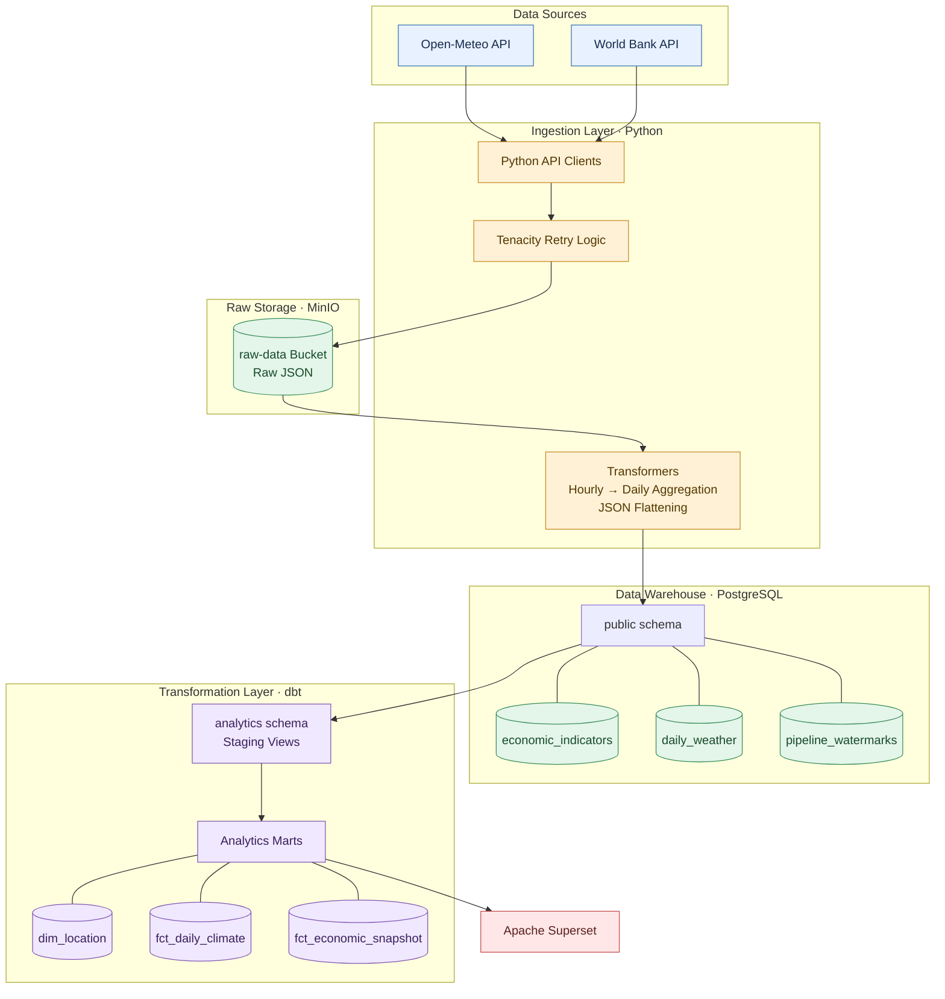

# Kenya Economic & Weather Intelligence Pipeline

A production-grade, fully Dockerized data engineering pipeline that ingests, stores, transforms, and visualizes economic and weather data for Kenya.

Built as a portfolio project demonstrating real-world data engineering practices: incremental ingestion, idempotent upserts, a dbt mart layer, Airflow orchestration, and MinIO raw data preservation.

---

## What It Does

| Layer | What happens |
|---|---|
| **Extract** | Fetches World Bank economic indicators and Open-Meteo hourly weather via REST API |
| **Raw Storage** | Uploads timestamped JSON snapshots to MinIO (S3-compatible data lake) |
| **Transform** | Aggregates hourly weather to daily; flattens World Bank nested records |
| **Load** | Upserts processed records into PostgreSQL (idempotent, revision-safe) |
| **Model** | dbt builds staging views and analytical mart tables |
| **Orchestrate** | Airflow DAG runs daily; weather uses watermarks for incremental-only fetches |
| **Visualise** | Apache Superset dashboards query the mart layer |

---


## Architecture




---


---

## Tech Stack

| Tool | Version | Role |
|---|---|---|
| Python | 3.12 | Ingestion, transformation |
| Apache Airflow | 2.10.5 | Orchestration |
| dbt-core | 1.9.3 | Transformation & testing |
| PostgreSQL | 16 | Analytical store |
| MinIO | latest | Raw data lake (S3-compatible) |
| Apache Superset | 6.1.0 | Dashboards |
| Docker Compose | v2 | Local deployment |

---

## Data Sources

| Source | Coverage | Update frequency |
|---|---|---|
| [World Bank API](https://datahelpdesk.worldbank.org/knowledgebase/articles/889392) | 8 annual economic indicators for Kenya (1960–present) | Annual |
| [Open-Meteo Archive](https://open-meteo.com/en/docs/historical-weather-api) | Hourly weather for 6 Kenyan cities | Daily (5-day lag) |

### Economic Indicators

| Code | Name |
|---|---|
| NY.GDP.MKTP.CD | GDP (current USD) |
| NY.GDP.MKTP.KD.ZG | GDP growth rate (%) |
| SP.POP.TOTL | Total population |
| FP.CPI.TOTL | Consumer price index |
| SL.UEM.TOTL.ZS | Unemployment rate (%) |
| NV.AGR.TOTL.ZS | Agriculture value added (% of GDP) |
| EG.ELC.ACCS.ZS | Access to electricity (% of population) |
| IT.NET.USER.ZS | Internet users (% of population) |

### Weather Locations

Nairobi · Mombasa · Kisumu · Nakuru · Eldoret · Garissa

---

## Quick Start

### Prerequisites

- [Docker](https://docs.docker.com/get-docker/) and Docker Compose v2

### 1. Clone and configure

```bash
git clone https://github.com/25thOliver/Kenya-Weather-Economic-Pipeline
cd kenya-economic-weather-pipeline
cp .env.example .env
# Edit .env and set strong passwords before continuing
